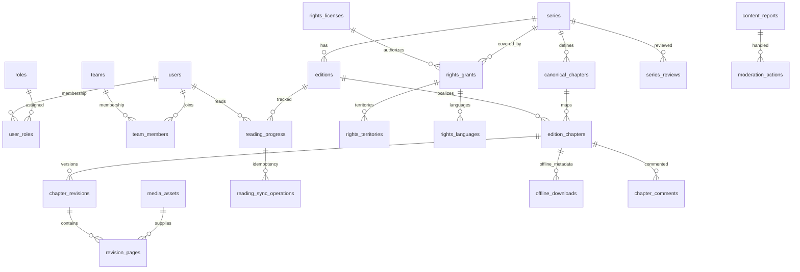

# Gate 06 — Data Model (source-derived, 2026-10-19)

**Status:** Gate 06 schema implemented in source; FINAL DATABASE ACCEPTANCE PENDING. This document describes migrations `2026_10_19_000101` through `000111`; it is not proof that they have been applied on any server. Legacy Laravel authentication, cache, jobs and passkey tables are excluded from the 36 Gate 06 domain tables.

## Identity and ownership

- Existing `users.id` is a **bigint**. Gate 06 uses **ULID** IDs for most content, rights, progress, reports and notification entities. Composite membership, lookup and preference tables instead use natural/composite primary keys or `users.id`.
- No new `permissions` or `role_permissions` tables have been deployed. `roles` and `user_roles` establish a role vocabulary/assignment only; `teams`, `team_members` and `content_assignments` capture team/editorial context. None of these schemas alone grant API authorization.
- Use explicit policy checks on the authenticated server in Gate 07, not flags sent from clients. Avoid transforming an unknown user/territory/language into public access.

## Complete table inventory (36)

| Migration | Created tables | Count |
| --- | --- | ---: |
| 000101 | `roles`, `user_roles`, `teams`, `team_members`, `series`, `title_aliases`, `genres`, `tags`, `series_genres`, `series_tags`, `canonical_chapters`, `editions` | 12 |
| 000102 | `media_assets`, `edition_chapters`, `chapter_revisions`, `revision_pages`, `content_assignments` | 5 |
| 000103 | `rights_licenses`, `rights_grants`, `rights_territories`, `rights_languages` | 4 |
| 000104 | constraints and 3 PostgreSQL triggers (no new table) | 0 |
| 000105 | `library_entries`, `custom_lists`, `custom_list_items` | 3 |
| 000106 | `reading_progress`, `reading_sync_operations` | 2 |
| 000107 | `offline_downloads` | 1 |
| 000108 | `series_reviews`, `chapter_comments` | 2 |
| 000109 | `community_reactions`, `content_reports`, `moderation_actions` | 3 |
| 000110 | `series_follows`, `notification_preferences`, `in_app_notifications` | 3 |
| 000111 | `audit_logs` and 1 PostgreSQL trigger | 1 |
| **TOTAL** | | **36** |

> In 000101, `genres` and `tags` are created in a `foreach`; a literal count of `Schema::create('...')` will undercount by two.

## Core publishing ERD

### Cross-row invariants and important keys

- `series.slug` unique; `title_aliases(series_id,locale,normalized_value)` unique; genres/tags joined by composite primary keys.
- `canonical_chapters(series_id,sort_key)` unique, while `display_number` is free text (`12.5`, `extra`). `canonical_chapters(id,series_id)` and `editions(id,series_id)` are additional unique targets for compound FKs.
- `edition_chapters(edition_id,canonical_chapter_id)` unique. `(edition_id,series_id)` and `(canonical_chapter_id,series_id)` both reference the *same* series. The nullable current published revision pointer references `(chapter_revisions.id,chapter_revisions.edition_chapter_id)` on PostgreSQL.
- `chapter_revisions(edition_chapter_id,revision_no)` unique, with positive revision number. `revision_pages(chapter_revision_id,page_index)` unique; page index starts at 1. A PostgreSQL trigger rejects page mutation of reviewed/published/archived/revoked revisions and another guards transitions on reviewed/published revisions.
- `media_assets.storage_key` unique and subject to defensive path checks; asset `status=ready`, dimensions and page ordering are required before a published pointer becomes valid. Actual storage-file existence/hash/content compliance must be checked by application services; DB metadata does not prove it.
- `rights_grants.edition_id` is optional and, when present, constrained to the matching series via composite FK. A grant has capability flags (`can_publish`, `can_translate`, `can_offline`), plus explicit territory and language rows. An empty set means **deny**, not unrestricted access.
- `library_entries(user_id,series_id)` unique; `custom_lists(user_id,normalized_name)` unique; `custom_list_items(custom_list_id,series_id)` unique. `custom_lists.is_public=false` is presently enforced by PostgreSQL CHECK until authorization for sharing exists.
- `reading_progress(user_id,edition_id)` unique. `last_edition_chapter_id`/`last_page_index` are the *last position*, distinct from `furthest_edition_chapter_id`/`furthest_page_index` for the *furthest progress*. Both chapter pointers are constrained to the matching edition. `reading_sync_operations(user_id,client_operation_id)` unique to support replay/idempotency; it is not a substitute for serialized server-side reconciliation.
- `offline_downloads(user_id,device_key_hash,edition_chapter_id)` unique; revision pointer must match chapter. `available` requires rights metadata at minimum; possession of metadata **never** authorizes retrieval/decryption of media bytes.
- `series_reviews(user_id,series_id)` unique, rating 1–5, moderation `pending` by default. `chapter_comments` may reference one parent in the same edition chapter through a composite FK. `community_reactions` and `content_reports` require exactly one supported target; review/comment-specific unique indexes dedupe a user/reporter per target.
- `series_follows(user_id,series_id)` composite primary key; `notification_preferences.user_id` primary FK; `in_app_notifications(user_id,dedupe_key)` unique, carrying event keys/IDs rather than spoiler text.
- `audit_logs` has a PostgreSQL `BEFORE UPDATE OR DELETE` trigger; owner/superuser-level database privileges can still bypass it, so this is **not tamper-proof audit storage**.

## Four PostgreSQL triggers

| Trigger | Table | Purpose |
| --- | --- | --- |
| `manga_revision_page_immutable` | `revision_pages` | Disallow changes on reviewed/finalized revision pages |
| `manga_revision_immutable` | `chapter_revisions` | Protect approved revisions from arbitrary edits |
| `manga_published_pointer_guard` | `edition_chapters` | Require complete published revision, pages, hash and ready assets |
| `manga_audit_immutable` | `audit_logs` | Reject update/delete of audit entries |

## Rights and visibility contract

`Series` and `Edition` include `publiclyReadableIn(territory,language,time)` query scopes. Reads fail closed for absent/invalid audience context and require published series/edition/chapter, unexpired active grant, an approved unexpired parent license, `can_publish=true`, explicit language, and either matching territory or an explicit `GLOBAL` territory. These query scopes are filters, **not authentication, ownership proof, media access authorization or permission to download**. Gate 07 must apply per-request server-side checks and Gate 10/14 must additionally check live offline rights.

## Schema evolution policy

1. Author forward-only additions in new, ordered migrations; do **not** rewrite 000101–000111 after acceptance without an approved recovery plan.
2. Define backward compatibility for clients in circulation; test both deployment ordering and data backfill with fictional fixtures.
3. For nullable/backfilled new columns: expand -> backfill in controlled batches -> verify -> enforce NOT NULL/constraints; provide explicit rollback caveats for irreversible changes.
4. Test on `manga_gate06_test` only with explicit owner authorization before running `RefreshDatabase`, migrate:fresh or rollback. Never direct these at `manga_app`.
5. Treat schema, permissions and rights changes as release gates requiring a backup, replayable evidence and owner sign-off.

**Source of truth:** `platform/database/migrations/2026_10_19_000101...000111`, `platform/app/Models`, `platform/app/Domain/Reading/ReadingSyncService.php`, and three `platform/tests/Feature/Gate06/*Test.php` files. This document does not establish legal clearance or production readiness.
